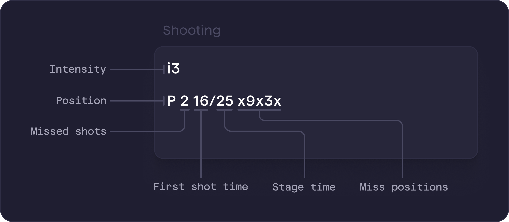

Record shooting from training or competition in the `Shooting` field — intensity, miss count, timing, and miss positions.


<PageMeta audience="Coaches & athletes" where="Web app" />

<Frame caption="Biathlon shooting entry syntax.">
  
</Frame>

Yarmill parses each entry into structured data for analysis, so follow the format and syntax below to keep your entries recognized correctly.

<Info>Accepted intensity names and shooting syntax are **configured per team and sport**, so some values may differ from this guide.</Info>

## Shooting entry syntax

### Parameters

<ParamField path="Intensity" required>
  Indicates the intensity level during which the shooting was performed.
  Always comes first in the entry and applies to all following lines until a new intensity is defined.

  Accepted values:
  - `i0`, `z0`, or `static` for static shooting
  - intensity name (usually `i1-i5`; some teams log levels `L0-L5` instead — see [When `L` is a level](#when-l-is-a-level))
  - `competition`, `race`, or `závod` for race shooting
</ParamField>

<ParamField path="Position" required>
  Defines the shooting position.
  Must follow the intensity and applies to all following entries until a new position is specified.
  
  Accepted values:
  - `P` or `L` for prone (`L` as in *ležka* or *liegend*) — if your team also logs intensity as levels, see [When `L` is a level](#when-l-is-a-level)
  - `S` for standing
</ParamField>

<ParamField path="Missed shots" required>
  Represents the number of missed shots in a stage.
  You can enter multiple numbers in sequence (e.g. `0321`) to log several stages at once using batch entry.
  The space after the position is usually optional: `P 0320` and `P0320` are the same. If your team logs intensity as levels, keep the space — see [When `L` is a level](#when-l-is-a-level).
  
  Accepted values:
  - integer `0-5`
  - `X+Y` for relay shooting, where `X` is the number of missed shots and `Y` is the number of spare rounds used

  Examples: `3`, `0+2`
</ParamField>

<ParamField path="First shot time & Stage time">
  Optional timing data for each shooting stage.
  Represents the time of the first shot and the total time spent on the stage.
  
  Accepted values:
  - times in seconds, separated by `/` (first shot time / stage time)
  - `-` for a missing or unknown value
  
  Examples: 
  - `14/29` – first shot at 14s, total stage time 29s
  - `-/25` – first shot time unknown, stage time 25s
  - `13/-` – first shot at 13s, stage time unknown
</ParamField>

<ParamField path="Miss positions and order">  
  Optional field that describes where missed shots went, using clock notation.
  You can also log the full shot sequence by entering all five shots and using `x` to mark hits.

  Accepted values:
  - clock numbers `1-12` to indicate miss positions
  - `'`, `` ` ``, or `,` as separators between values
  - `x` to indicate a hit when logging all five shots in order
  
  Examples:
  - `3' 11' 12'` – three misses at 3, 11 a 12 o'clock
  - `2 10` – two misses at 2 and 10 o'clock 
  - `4x5xx` – miss at 4, hit, miss at 5, hit, hit (first and third shot missed)
</ParamField>

### When `L` is a level

Some teams log intensity as levels (`L1`, `L2` …), and some write prone as `L`. A line like `L2` can then mean either an intensity level or a prone stage with 2 misses. Yarmill decides from the whole entry, in this order:

1. **The entry writes prone as `P` anywhere** → `L` followed by a digit is an intensity level.
2. **The entry sets intensity with an `i` level or as a race** (`competition`, `race`, `závod`) → `L` is prone.
3. **Otherwise the layout decides:** stages written without spaces (`L2`, `S1`) → `L` is prone; stages written with spaces (`S 2 12/28`) → a line with only `L` and a digit is an intensity level.

So the same letters can be read two ways, depending on the space:

```json title="L2 / S2 – read as prone"
L2   // prone, 2 misses
S2   // standing, 2 misses
```

```json title="L2 / S 2 – read as a level"
L2    // intensity level 2
S 2   // standing, 2 misses
```

<Tip>Keep one meaning per team: if you log intensity as levels, write prone as `P` and keep a space after the position (`S 2`); if you write prone as `L`, set intensity with `i` levels.</Tip>


## Examples

```json title="Batch entry (no details) – v1"
i0       // static shooting
P 0320   // 4 static prone stages – 0, 3, 2, 0 misses
S 0210   // 4 static standing stages – 0, 2, 1, 0 misses
```

```json title="Batch entry (no details) – v2"
i1 P 0320   // prone shooting in i1 – 0, 3, 2, 0 misses
i2 S 0210   // standing shooting in i2 – 0, 2, 1, 0 misses
```

```json title="Prone written as L"
i3   // shooting in i3 intensity
L2   // prone, 2 misses
L1   // prone, 1 miss
S1   // standing, 1 miss
S3   // standing, 3 misses
```

```json title="Intensity as levels"
L2       // intensity level 2
P 0320   // 4 prone stages – 0, 3, 2, 0 misses
S 1102   // 4 standing stages – 1, 1, 0, 2 misses
```

```json title="Detailed entry with miss positions"
i2              // shooting in i2 intensity
P 3 1' 3' 11'   // prone, 3 misses at 1, 3, and 11 o'clock
S 2 7' 10'      // standing, 2 misses at 7 and 10 o'clock
```

```json title="Detailed entry with times & miss positions"
i3              // shooting in i3 intensity
P 1 14/29 6     // prone, 1 miss, first shot at 14s, total stage time 29s, miss at 6 o'clock
P 2 -/26 12 6   // prone, 2 misses, total stage time 26s, misses at 12 and 6 o'clock
```

```json title="Detailed entry with order of missed shots"
competition       // race shooting
P 0 13/25         // prone, clean – first shot at 13s, total stage time 25s
P 1 12/26 x9xxx   // prone, 1 miss – second shot missed at 9 o'clock
S 0               // standing, clean
S 2 14/28 3xxx11  // standing, 2 misses – first shot missed at 3 o'clock, last at 11 o'clock
```

## Pro tips

- **Be concise** – use batch mode when you don’t need detailed info like times or miss positions.
- **Double-check your entries** – go to `Analytics / Shooting Analysis` and check the table at the bottom to confirm your entries parsed correctly.
